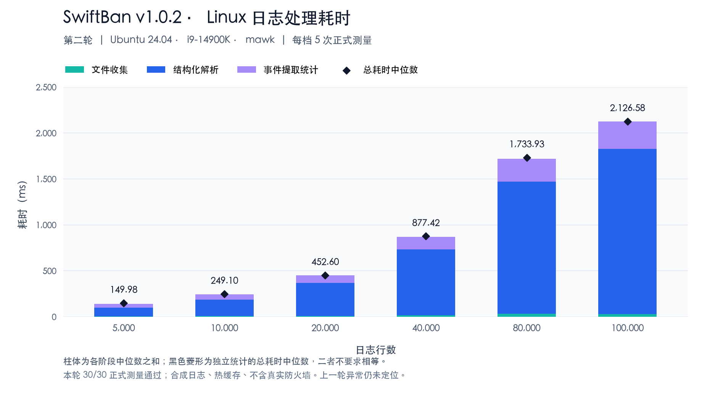

<div align="center">

# 🛡️ SwiftBan

**基于 Nginx / Apache 日志的实时攻击检测与自动封禁系统**

轻量级 · 零依赖 · 零误封 的自建站 WAF

[](VERSION)
[](LICENSE)
[]()

[官网](https://awei-robot.github.io/SwiftBan-Community/) · [商业版](https://github.com/awei-robot/SwiftBan) · [问题反馈](https://github.com/awei-robot/SwiftBan-Community/issues)

</div>

---

## 🎯 这是什么

SwiftBan 通过分析 Apache、Nginx 和 Nginx Proxy Manager 访问日志，实时识别攻击行为（扫描、注入、爆破、CC），并自动用 iptables 封禁恶意 IP。

**核心理念：只封禁明确攻击特征，绝不误伤正常业务流量。**

已在生产环境（腾讯云 NPM + Docker）长期运行，累计拦截数千次攻击，**零误封记录**。

## ✨ 特性

- 🔍 **11 个检测维度**：域名扫描（444）、404/400 扫描、恶意路径、漏洞载荷（SQL 注入/XSS/Log4j/路径穿越）、可疑 UA、登录爆破、单接口高频/速率（均仅告警，避免 NAT 误伤）、空 UA、高频观察
- 🔥 **自动封禁**：iptables/ip6tables 双栈，`DOCKER-USER` 链原生兼容 Docker 端口映射
- 🛡️ **双层白名单**：内置内网 IP + 自定义文件（支持 CIDR 网段，动态生效）
- ⏱️ **自动解封**：TTL 过期自动恢复（默认 3 天）
- 💾 **状态持久化**：服务器重启/规则丢失后自动恢复
- 📦 **零依赖**：纯 Bash + GNU 工具（gawk），单机 5 分钟部署
- 🔇 **防日志噪音**：白名单 IP 静默跳过
- 🌐 **时区安全**：按日志时区偏移换算 UTC，拒绝未来时间，精确窗口统计
- 🧾 **日志格式**：NPM standard/proxy、Nginx combined、Apache common/combined/vhost combined 自动识别，支持未压缩轮转文件

## 🚀 快速开始

### 安装

```bash
git clone https://github.com/awei-robot/SwiftBan-Community.git
cd SwiftBan-Community
sudo ./install/install.sh
```

依赖：Linux（/proc）+ Bash 4.1+ + root + iptables + gawk（awk 需支持 mktime 及区间正则），以及 util-linux 的 flock、setsid。安装脚本自带依赖检查。

`iptables` 必须存在；`ip6tables` 可选，缺失时提示 IPv6 封禁不可用，IPv4 功能正常。未成功执行的 IPv6 封禁不会写入封禁状态。

安装时会显示当前日志目录和防火墙链，请按部署环境确认或输入新值；直接回车保留现有值。Docker 端口映射通常使用 `DOCKER-USER`，裸机 Nginx 通常使用 `INPUT`。确认后安装程序会运行配置检查。

### 配置

编辑 `/etc/swiftban/swiftban.conf`：

```ini
LOG_DIR=/root/proxy-manager/data/logs   # Nginx/Apache/NPM 日志目录
LOG_FORMAT=auto                         # auto / npm_standard / npm_proxy / combined / apache_common / apache_combined / apache_vhost_combined
BAN_TTL=259200                          # 封禁时长（秒，0=永久）
WHITELIST=127.0.0.1,::1,192.168.224.1   # 白名单
```

`auto` 可在同一日志目录混合识别 Apache common、combined 和虚拟主机 combined（`%v` / `%v:%p`）。Apache common 没有 UA/Referer，因此不会触发这些字段相关的检测或空 UA 检测；客户端 `%h` 应输出数字 IP。

### 使用

```bash
swiftban run --dry-run     # 演练模式：只检测不封禁（建议先跑 1-2 天观察）
swiftban watch             # 查看近24小时观察记录（仅告警）
swiftban watch --dry-run   # 查看演练观察记录
swiftban list --dry-run    # 查看最近演练候选及复核信息
swiftban run               # 正式检测（cron 每分钟自动执行）
swiftban stop              # 终止当前扫描、撤销管理的规则，保留banlist和TTL
swiftban start             # 恢复未过期封禁并立即正式扫描
swiftban status            # 分别查看当前执行、最近模式和定时任务配置
sudo swiftban doctor       # 检查依赖、配置、防火墙、状态和调度并给出修复提示
swiftban list              # 列出封禁 IP（默认快速，不查询来源地）
swiftban list --geo        # 附加来源地和运营商
swiftban list --ip 114.252.120.44  # 查询该IP原始访问日志
swiftban geo refresh       # 手动补全封禁/观察IP来源地
swiftban ban 1.2.3.4       # 手动封禁
swiftban unban 1.2.3.4     # 手动解封
swiftban whitelist add 10.0.0.0/8   # 白名单管理
swiftban whitelist remove 10.0.0.0/8
swiftban whitelist list
```

### 单 IP 原始访问详情

```bash
swiftban list --ip 114.252.120.44
swiftban list --ip 114.252.120.44 --since 30m --limit 200
swiftban list --help
```

按解析出的客户端 IP 精确查询 Apache、Nginx/NPM **原始访问日志**，显示来源文件、行号及原始行（含日志原有的请求方法、URI、状态码、UA 等字段），按访问时间从早到晚排列。支持等价 IPv6 写法，不会把 URI、UA 或 Referer 中的 IP 当成访问来源。

默认查询日志目录第一层全部支持格式日志和未压缩轮转文件，**不限制文件修改时间，也不套用检测窗口**，按日志时间从早到晚最多显示100条；`--since` 可选择最近时段（支持 `m`/`h`/`d`），`--limit` 可调整数量。压缩或已删除的日志无法查询，未查到不代表没有历史访问。原始记录不做轮转去重，无效或未来日志不展示。查询只读，不修改封禁和 WATCH，也不等待扫描锁。

### WATCH 观察列表

WATCH 用于复核流量超限情况。单接口高频（窗口内总量）、单接口速率（每分钟）和总请求高频均只记录观察，不单独触发封禁；其他攻击规则仍可封禁同一 IP。

```bash
swiftban watch                          # 正式扫描近24小时，最多50项
swiftban watch --ip 123.114.230.31       # 筛选指定IP，支持IPv4/IPv6
swiftban watch --rule api               # 单接口高频
swiftban watch --rule apirate           # 单接口速率
swiftban watch --rule freq              # 总请求高频
swiftban watch --since 7d --limit 100    # 最近7天，最多100项
swiftban watch --dry-run                # 只查看演练观察
swiftban watch --json                   # JSON导出，可组合其他筛选参数
swiftban watch --samples <告警ID>       # 查看告警关联的原始日志样本
swiftban watch --geo                    # 附加来源地与运营商
swiftban watch --help                   # 完整命令说明
```

列表按最后发现时间倒序，展示告警 ID、样本数、最近计数/当时阈值、峰值、命中轮次、首次/最后发现（UTC）和接口。按 IP＋规则＋域名及完整 URI 聚合；总请求高频按 IP 聚合。统计限于查询时间范围，重叠窗口的请求数不累加；同一扫描中多个分钟超限只计一轮，并取最大分钟计数。

每条告警最多保存5条原始访问记录样本；少于5条时全部保存。样本覆盖最早2条和最新3条，并显示原始日志时间、扫描时的来源文件、事件偏移标识及完整原始行。样本在扫描时快照保存，因此日志轮转或删除后仍可查看；样本与 WATCH 记录使用相同的保留期。原始行可能包含敏感 URI、UA 或 Referer，访问权限与 WATCH 状态目录一致。

正式与演练观察独立保存在 `${STATE_DIR}/watch/`，默认保留 **7 天**，可在配置中设置 `WATCH_RETENTION_DAYS`。每轮完整扫描后保存，查询不等待扫描锁。升级前的控制台 WATCH 输出不会补录，需完成新扫描才开始积累记录；列表为空时请检查是否执行过对应模式的扫描，以及查询时间范围。`swiftban status` 可查看观察摘要，`swiftban doctor` 可检查记录目录及格式。

更多存储与清理说明见 [配置说明](docs/configuration.md#watch-观察记录)。

### IP 来源地（手动刷新）

封禁列表、WATCH 和单 IP 原始日志明细均可显示本地缓存的来源地与运营商。扫描和查看命令**不会联网查询**，首次显示“未查询”时请手动刷新：

```bash
sudo swiftban geo refresh                       # 封禁IP优先，再处理正式/演练WATCH
sudo swiftban geo refresh --ip 8.8.8.8           # 查询单个IP
sudo swiftban geo refresh --ip 8.8.8.8 --force   # 强制更新，不绕过接口限流
swiftban geo show 8.8.8.8                       # 查看来源地、ISP、组织、AS和缓存时间
swiftban geo --help
```

需要可选依赖 `curl` 和 `jq`（Debian/Ubuntu：`sudo apt install curl jq`）；缺失时检测照常运行。成功缓存有效7天，失败后退避1小时并保留旧的成功数据，过期数据带标记展示。每次最多请求30个IP，未处理完时再次执行刷新；无独立定时任务。缓存保存于 `${STATE_DIR}/geo/`，与封禁、WATCH状态分开。

归属地来自 [ip-api 免费接口](https://ip-api.com/docs/api:json)，使用 HTTP，官方限制每个出口IP每分钟45次且不允许商业使用。刷新串行限速并遵守服务端限流响应；私有/本地地址不发请求。来源地表示网络归属信息，仅供复核，不作为自动封禁依据。

### 定时任务

```bash
swiftban install-cron      # 安装每分钟执行 cron（或使用 systemd timer，见 deploy/）
```

`--dry-run` 只影响本次执行，不会改变 cron/systemd 的模式。上面的默认 cron 是正式检测；如需连续演练，应将任务明确配置为 `swiftban run --dry-run`，再检查 `status` 显示的原始命令。

`stop` 保留定时任务，但通过持久停止标记跳过后续正式检测，服务器重启后也不会自动解除停止。停止期间 TTL 继续计时；`start` 仅恢复未到期、非白名单记录，永久封禁照常恢复。停止时仍允许显式演练和手动解封，禁止手动新增封禁。撤销失败时会明确显示“停止未完成”，修复问题后重试 `stop`，不能直接 `start`。

演练候选原子保存为 `${STATE_DIR}/dry-run.tsv`，不进入 `banlist.txt`；失败或中断保留上一次完整结果，成功的零候选结果也会更新文件。`status` 分别报告“控制状态”“当前执行”“最近执行”“定时配置”，运行中显示当前阶段已耗时，空闲时显示最近扫描总耗时和处理量。`doctor` 另提供最近30天耗时分位数、阶段耗时、最慢10个日志文件和增量快照结构诊断。耗时采用 Linux 单调时钟；指标保存在 `${STATE_DIR}/scan/metrics/`，目录和文件仅所有者可读，保留30天。失败和停止的扫描也保存已完成阶段耗时；旧版运行记录不补生成指标。诊断只读状态，不自动修复损坏快照。最近一次演练不代表已配置的正式任务也处于演练模式。

## 📊 版本对比

| 能力 | 社区版 | [商业版](https://github.com/awei-robot/SwiftBan) |
|------|:---:|:---:|
| 11 维度检测 + iptables 双栈封禁 | ✅ | ✅ |
| CLI 管理 / cron 定时 | ✅ | ✅ |
| **Go 单二进制**（零依赖，含 Linux/Windows） | — | ✅ |
| **Web 管理台**（仪表盘/封禁/白名单，Basic Auth） | — | ✅ |
| **Windows 服务版**（RDP 爆破防护） | — | ✅ |
| **多机集中控制台**（Enterprise） | — | ✅ |
| license 授权 / 规则订阅 | — | ✅ |

> 商业版面向需要 Web 管理界面、Windows 服务器防护、多机集中管理的场景。社区版永久免费、MIT 开源。

## 🏗️ 架构

```
Apache/Nginx/NPM 活动日志及未压缩轮转文件
      │ 新文件按3分钟mtime发现，已登记inode按字节游标续读，跨轮转保留窗口事件
      ▼
统一字段解析 → 按日志时区转 UTC → WINDOW 时间过滤
      ▼
字段限定的特征统计（单次 awk 聚合）
      ▼
白名单检查 → 阈值决策 → 封禁/观察
      ▼
iptables -I DOCKER-USER -s IP -j DROP
      ▼
banlist.txt 持久化 / TTL 自动解封 / 规则自动恢复
```

详细设计见 [docs/architecture.md](docs/architecture.md)，配置项见 [docs/configuration.md](docs/configuration.md)。

只支持上述已定义格式，未知或非法记录会跳过并报告数量；读取或解析程序失败时停止本轮新增封禁。新文件通过最近3分钟 mtime发现，已登记文件按设备号/inode和字节游标读取新增完整行；事件快照保留当前 WINDOW，rename 轮转后仍可续读和跨轮转统计。copytruncate 会通过文件缩短或末行指纹变化检测后重读并去重，但复制与截断之间仍可能丢日志。状态保存在 STATE_DIR/scan/state.tsv，不使用数据库；快照含窗口内原始行并限制为仅 root 可读；升级后不回填未登记的旧日志。gzip、JSON、syslog 和任意自定义格式暂不支持。接口按 IP + 域名 + 完整 URI（保留查询参数）分组；combined 使用日志文件家族隔离站点。

上线前请在目标版本的脱敏真实日志上执行 dry-run，检查格式错误及封禁候选。历史封禁及阈值不会自动调整。

## 🧪 测试

```bash
bash tests/test_detector.sh     # 白名单、格式/时区、字段边界、轮转、决策和故障回归
bash tests/test_log_fixtures.sh # 自编六种格式夹具、字段黄金结果、候选与WATCH验收
bash tests/test_maintenance.sh  # IPv6规范化、状态读写失败、严格配置和cron安装回归
shellcheck bin/swiftban.sh lib/*.sh tests/test*.sh install/install.sh
bash tests/test_runtime.sh      # Linux真实进程会话/锁测试，防火墙与调度使用替身
```

macOS 测试会优先使用 gawk；awk 缺少 mktime 或区间正则支持时测试失败，不会跳过时间解析检查。测试中的防火墙操作均使用 mock。

格式夹具与验收覆盖见 [日志格式验收](docs/log-format-acceptance.md)。夹具均为自编固定样例，不替代目标环境脱敏日志的上线前 dry-run。

运行管理集成测试需要 Linux，macOS 只运行可移植回归及静态检查。Python 3 仅用于测试防火墙替身，不是程序运行时依赖。

## 📈 Linux 日志解析基准（v1.0.2）

**测试环境**：Ubuntu 24.04.2 LTS / Linux 6.8.0-54、Intel Core i9-14900K、约 126 GiB 内存、NVMe ext4、系统 mawk 1.3.4（20240123）。以下为 2026-11-16 第二轮实测。

**方法**：合成日志混合 NPM proxy、NPM standard、Nginx combined 三种格式，覆盖 20 类正常与攻击场景。每档预热 1 次、正式测量 5 次，串行运行并逐字段、逐事件校验。样本文件均在最近 3 分钟内修改，条目位于 `WINDOW=7200` 内；采用热缓存，不清理系统缓存、不修改系统配置、不调用真实防火墙。计时不包含 SSH、样本生成、结果校验和 shell 启动。

| 日志行数 | 收集 ms | 解析 ms | 提取统计 ms | 总耗时 ms | 吞吐（行/秒） | 峰值 RSS MiB |
|---:|---:|---:|---:|---:|---:|---:|
| 5,000 | 5.19 | 94.35 | 42.98 | 149.98 | 33,337 | 5.16 |
| 10,000 | 7.61 | 180.51 | 58.32 | 249.10 | 40,144 | 8.44 |
| 20,000 | 9.03 | 359.57 | 83.61 | 452.60 | 44,189 | 14.06 |
| 40,000 | 15.83 | 718.47 | 137.70 | 877.42 | 45,588 | 18.98 |
| 80,000 | 31.73 | 1,439.56 | 250.22 | 1,733.93 | 46,138 | 27.42 |
| 100,000 | 30.50 | 1,796.17 | 301.52 | 2,126.58 | 47,024 | 31.64 |



耗时均为各列独立计算的中位数；堆积柱为收集、解析和提取阶段中位数之和，黑色菱形表示总耗时中位数，因此柱高与总耗时不要求严格相等。RSS 为测量中的最大单进程内存，不是进程树的同时内存总和。

本轮 **30/30 次正式测量、6/6 次预热全部通过校验**。上一轮曾出现有效记录被跳过和 mawk 段错误，根因仍未确定；本轮未复现不代表已修复，合成日志结果也不构成生产容量保证。


## 📋 路线图

详见 [docs/roadmap.md](docs/roadmap.md)。

## 📄 许可证

MIT License

## 🙏 致谢

在腾讯云 NPM + Docker 生产环境长期验证，累计拦截数千次攻击，零误封。
